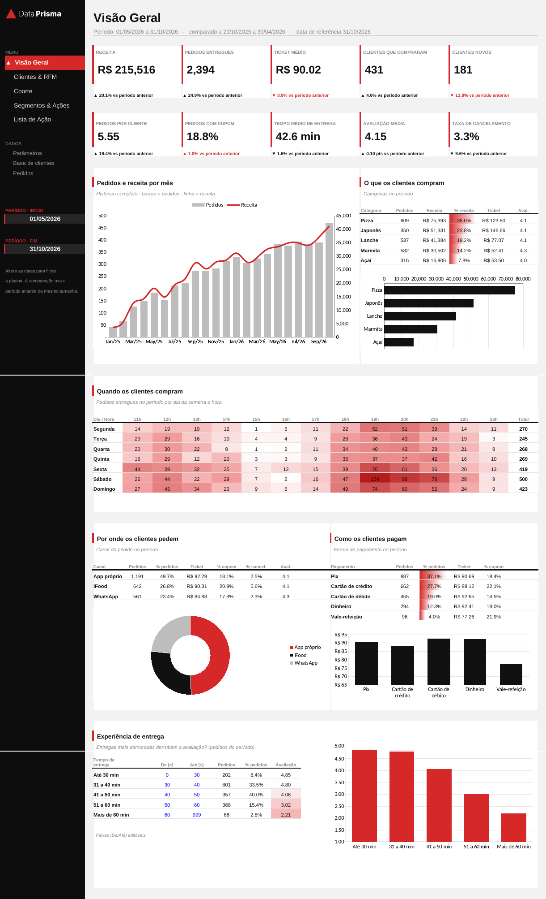
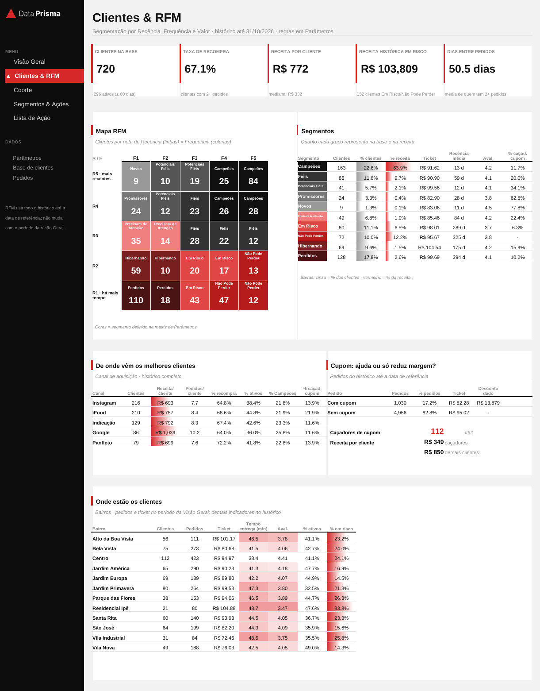
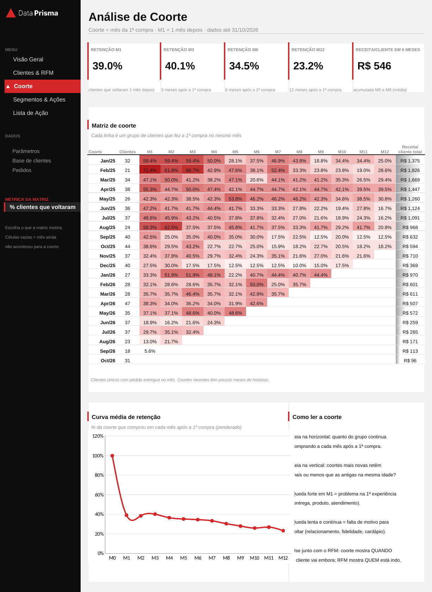
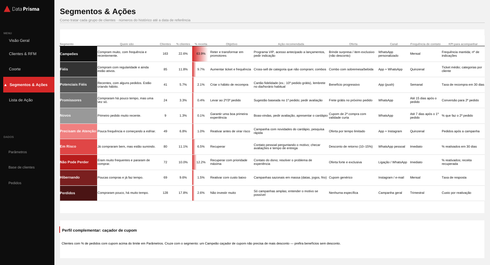
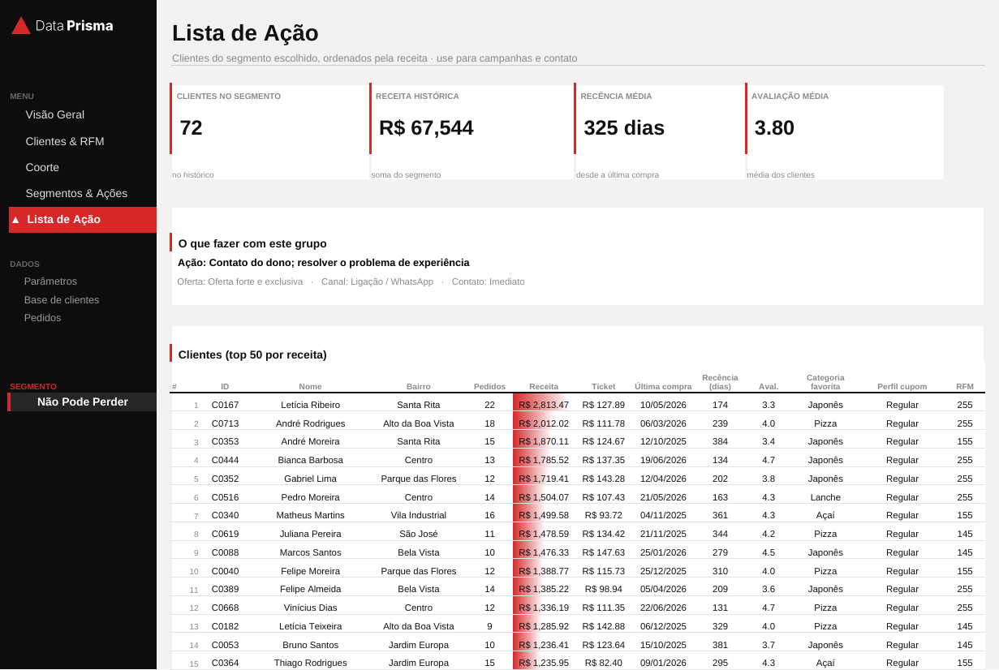

# Comportamento de Clientes — Dashboard de Delivery em Excel

Dashboard em Excel que mostra **quem são os clientes de um delivery, como eles compram e quando deixam de comprar**. A partir disso, cada cliente é colocado em um segmento com uma ação recomendada.

Tudo é calculado com fórmulas nativas do Excel (sem macros, sem Power Query, sem tabela dinâmica). O arquivo abre em qualquer versão a partir do Excel 2010.



## Perguntas de negócio que o dashboard responde

| Pergunta | Onde |
| --- | --- |
| A receita, o ticket e a base de clientes estão crescendo em relação ao período anterior? | Visão Geral |
| Em quais dias e horários os clientes pedem? | Visão Geral · mapa de calor |
| Quais categorias, canais e formas de pagamento concentram a receita? | Visão Geral |
| Entrega demorada derruba a avaliação? | Visão Geral · experiência de entrega |
| Quem são os melhores clientes e quem está indo embora? | Clientes & RFM |
| Qual canal de aquisição traz clientes que ficam? | Clientes & RFM |
| O cupom aumenta o ticket ou só reduz margem? | Clientes & RFM |
| Em que momento depois da 1ª compra os clientes param de voltar? | Coorte |
| O que fazer com cada grupo de clientes, e com quem falar primeiro? | Segmentos & Ações · Lista de Ação |

## Técnicas utilizadas

- **Segmentação RFM** (Recência, Frequência, Valor) com notas de 1 a 5 e matriz R×F editável, gerando 10 segmentos (Campeões, Fiéis, Em Risco, Não Pode Perder, Perdidos…).
- **Análise de coorte** mensal: retenção de M1 a M12 por mês da 1ª compra e curva média de retenção ponderada pelo tamanho de cada coorte.
- **Comparação com o período anterior** de mesmo tamanho em todos os indicadores, com seta ▲/▼ colorida conforme a variação for boa ou ruim.
- **Perfil complementar "caçador de cupom"**, cruzado com os segmentos.
- **Lista de ação** ranqueada por receita dentro do segmento escolhido, sem usar FILTRO nem CLASSIFICAR.
- **Modelo em camadas:** dados brutos → base por cliente → apoio de cálculo → páginas de apresentação.

## Páginas

| Clientes & RFM | Coorte |
| --- | --- |
|  |  |

| Segmentos & Ações | Lista de Ação |
| --- | --- |
|  |  |

Os filtros ficam no menu lateral de cada página: período (Visão Geral), métrica da coorte (Coorte) e segmento (Lista de Ação).

## Estrutura do repositório

```
├── Delivery_Comportamento_Clientes.xlsx   ← o dashboard
├── dados/
│   ├── pedidos.csv                        ← 6.211 pedidos (jan/2025 a out/2026)
│   └── clientes.csv                       ← 720 clientes
├── scripts/
│   └── montar_dashboard.py                ← monta o .xlsx com fórmulas, páginas e gráficos
├── docs/
│   └── FORMULAS.md                        ← cada fórmula e cada decisão de estrutura explicadas
├── assets/logo_dp.png
└── imagens/                               ← prints das páginas
```

## Os dados

O dataset é **sintético e foi gerado pelo Claude (IA da Anthropic)**, com perfis de comportamento variados (cliente frequente, ocasional, que abandona, novo, caçador de cupom…). Esses perfis não estão no arquivo: o dashboard precisa encontrar os grupos sozinho, como aconteceria com dados reais.

| Arquivo | Colunas principais |
| --- | --- |
| `pedidos.csv` | ID_Pedido, Data, Hora, Dia_Semana, ID_Cliente, Categoria, Valor_Total, Desconto, Cupom, Forma_Pagamento, Canal_Pedido, Tempo_Entrega_Min, Avaliacao, Status |
| `clientes.csv` | ID_Cliente, Nome, Bairro, Canal_Aquisicao, Faixa_Etaria, Data_Cadastro |

## Como reproduzir

```bash
pip install -r requirements.txt
python scripts/montar_dashboard.py   # recria o .xlsx a partir de dados/*.csv
```

Ao abrir o arquivo, o Excel calcula todas as fórmulas.

## Documentação

[docs/FORMULAS.md](docs/FORMULAS.md) explica a arquitetura, os parâmetros, a fórmula de cada coluna e de cada indicador, a lógica do RFM e da coorte, as decisões visuais e as limitações.

---

**Ferramentas:** Excel · Python (pandas, openpyxl) · dados gerados com Claude
**Autor:** Magdiel Arruda · [LinkedIn](https://www.linkedin.com/in/magdiel-arruda-42093322a) · Data Prisma
